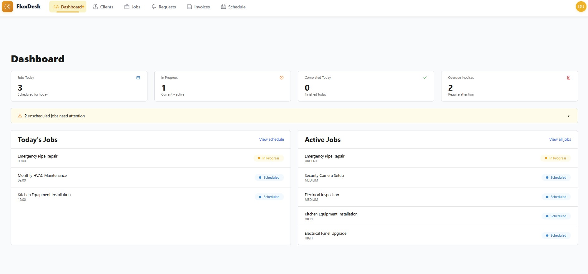
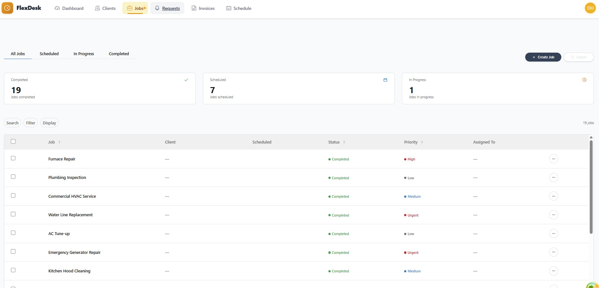
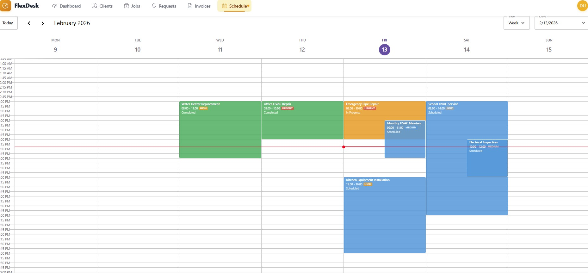
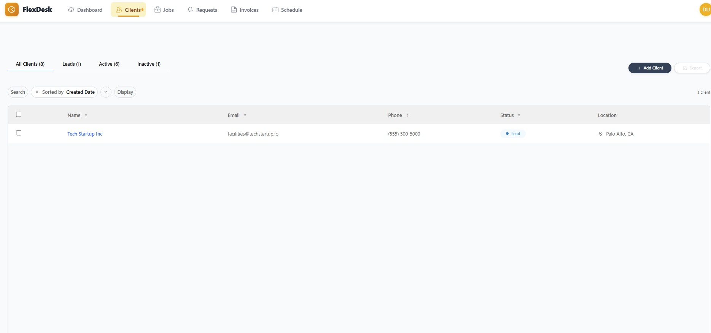
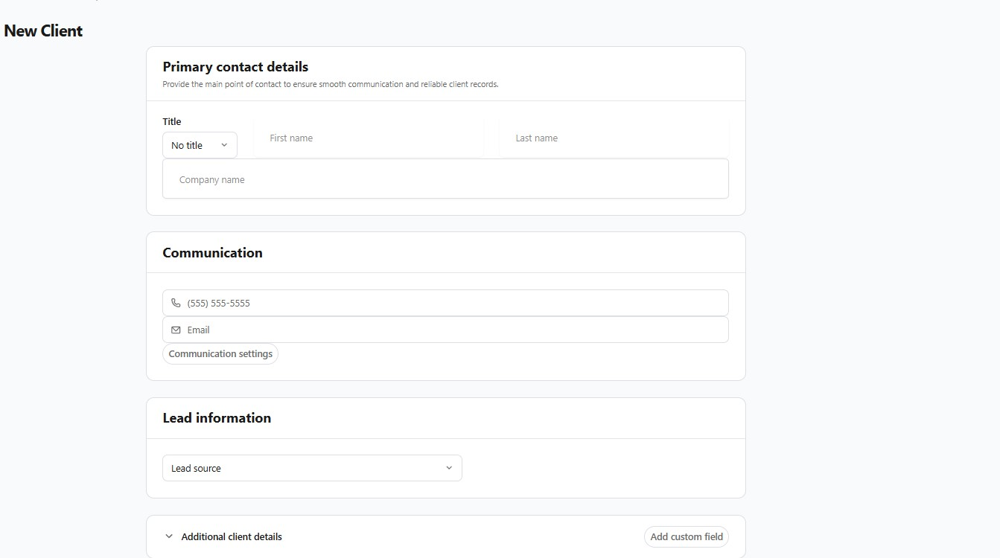
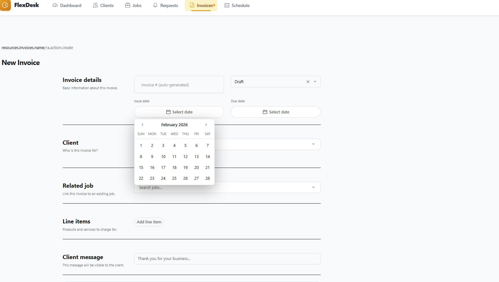
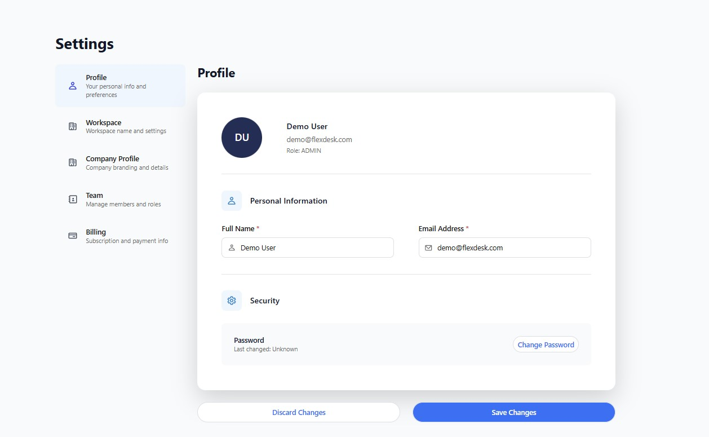
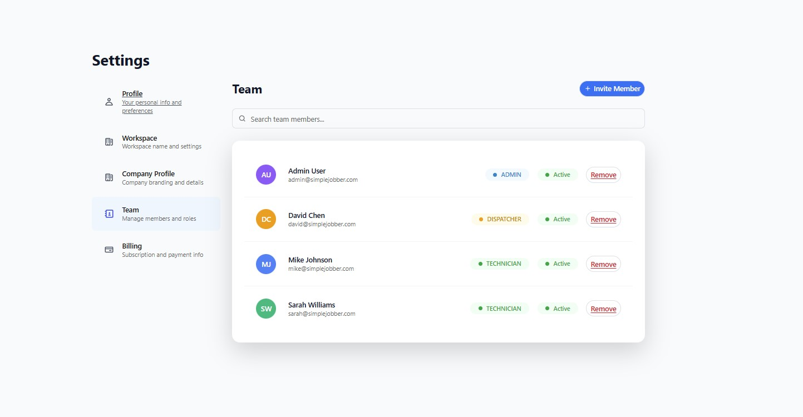

# FlexDesk

An open-source field service management (FSM) platform built for HVAC technicians, plumbers, electricians, and landscapers. Manage jobs, customers, invoices, scheduling, and your team -- all from one place.

## Dashboard

Get a real-time overview of your day: jobs scheduled, in progress, completed, and overdue invoices at a glance.



## Job Management

Track every job from creation to completion. Filter by status, assign priority levels, and keep your team on the same page.



## Schedule

A weekly calendar view with color-coded job blocks. See your team's workload, spot conflicts, and drag to reschedule.



## Client Management

Organize your clients with status tracking (Leads, Active, Inactive), search, and sortable columns. Everything you need to manage your customer relationships.



<details>
<summary>New Client Form</summary>

Add clients with structured contact details, communication preferences, lead source tracking, and custom fields.



</details>

## Invoicing

Create professional invoices linked to jobs, with line items, date selection, and custom client messages.



## Settings & Team Management

Configure your workspace, manage team members with role-based access (Admin, Dispatcher, Technician), and control billing.

<p>
  
  
</p>

## Tech Stack

| Layer | Technology |
|-------|-----------|
| Backend | NestJS, Prisma ORM, PostgreSQL |
| Frontend | React 18, Next.js, Vite |
| Mobile | React Native |
| Monorepo | pnpm workspaces + Nx |
| Auth | JWT + Google OAuth |
| Payments | Stripe |
| Email / SMS | SendGrid, Twilio |
| Maps | Google Maps API |

## Features

- **Job management** -- status tracking, priority levels, scheduling, and geofencing
- **Client CRM** -- leads pipeline, contact management, and status tracking
- **Invoicing** -- create, send, and track invoices with Stripe payments
- **Team scheduling** -- weekly calendar with drag-and-drop, technician assignment
- **Role-based access** -- Admin, Dispatcher, and Technician roles
- **Google Maps** -- routing, job locations, and distance calculations
- **Authentication** -- Google OAuth and email/password login
- **Offline-first** -- works without connectivity, syncs when back online
- **Multi-tenant** -- isolated workspaces with row-level security
- **SMS & email notifications** -- via Twilio and SendGrid

## Getting Started

### Prerequisites

- [Node.js](https://nodejs.org/) >= 20
- [pnpm](https://pnpm.io/) >= 8
- [Docker](https://www.docker.com/) (for PostgreSQL)

### 1. Clone and install

```bash
git clone https://github.com/Paulo-BatistaFerraz/FlexDesk.git
cd FlexDesk
pnpm install
```

### 2. Configure environment

```bash
cp .env.example .env
cp packages/flexdesk-server/.env.example packages/flexdesk-server/.env
```

Edit both `.env` files. At minimum, set:

- `DATABASE_URL` -- your PostgreSQL connection string
- `JWT_SECRET` -- generate with `openssl rand -hex 32`
- `JWT_REFRESH_SECRET` -- generate with `openssl rand -hex 32`

All external services (Stripe, SendGrid, Twilio, Google Maps) are optional for local development.

### 3. Start the database

```bash
docker compose up -d postgres
```

### 4. Run migrations

```bash
cd packages/flexdesk-server
pnpm run db:migrate
cd ../..
```

### 5. Start development servers

```bash
pnpm run dev:server    # Backend API on :3001
pnpm run dev:admin     # Admin frontend on :3000
pnpm run dev:preview   # Preview app on :5173
```

Or run everything at once:

```bash
pnpm nx run-many --target=dev --projects=flexdesk-server,flexdesk-admin,flexdesk-preview-v2
```

### 6. Verify

Open http://localhost:3000 and you should see the dashboard.

## Project Structure

```
FlexDesk/
├── packages/
│   ├── flexdesk-server/        # NestJS backend API
│   ├── flexdesk-admin/         # Next.js admin dashboard
│   ├── flexdesk-preview-v2/    # Vite customer-facing app
│   ├── flexdesk-website/       # Next.js marketing website
│   ├── flexdesk-mobile/        # React Native mobile app
│   ├── flexdesk-core/          # Shared library (API client, auth, hooks)
│   ├── flexdesk-types/         # Shared TypeScript types
│   ├── flexdesk-ui/            # Shared UI components
│   └── flexdesk-agent/         # AI agent utilities
├── docker-compose.yml          # Local PostgreSQL
├── .env.example                # Environment template
└── .env.production.example     # Production environment template
```

## Architecture

**Offline-First** -- IndexedDB caching with a sync manager. Field workers can use the app without connectivity; changes queue locally and sync when back online.

**Multi-Tenant** -- Every query is workspace-scoped via Prisma middleware that enforces row-level security. Each workspace is fully isolated.

**Modular** -- Domain logic lives in `src/modules/` (job, technician, billing, object-record). Each module owns its API layer, hooks, components, and types.

## Commands

```bash
pnpm install                          # Install dependencies
pnpm run dev:server                   # Start backend
pnpm run dev:admin                    # Start admin frontend
pnpm run dev:preview                  # Start preview app

# Database
cd packages/flexdesk-server
pnpm run db:migrate                   # Run migrations
pnpm run db:studio                    # Open Prisma Studio
pnpm run db:seed                      # Seed permissions

# Quality
pnpm run test                         # Run tests
pnpm run lint                         # Lint all packages
pnpm run build                        # Build all packages
```

## Environment Variables

See `.env.example` for all variables. Key categories:

| Category | Required | Variables |
|----------|----------|-----------|
| Database | Yes | `DATABASE_URL` |
| Auth | Yes | `JWT_SECRET`, `JWT_REFRESH_SECRET` |
| Server | Yes | `PORT`, `NODE_ENV`, `CORS_ORIGIN` |
| Stripe | No | `STRIPE_SECRET_KEY`, `STRIPE_WEBHOOK_SECRET` |
| Email | No | `SENDGRID_API_KEY`, `SENDGRID_FROM_EMAIL` |
| SMS | No | `TWILIO_ACCOUNT_SID`, `TWILIO_AUTH_TOKEN` |
| Maps | No | `GOOGLE_MAPS_API_KEY` |
| OAuth | No | `GOOGLE_CLIENT_ID`, `GOOGLE_CLIENT_SECRET` |

## Deployment

See [DEPLOYMENT.md](./DEPLOYMENT.md) for instructions on deploying to Railway (backend) and Vercel (frontend).

## License

MIT License. See [LICENSE](./LICENSE) for details.
